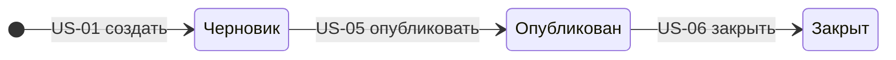

# Бэклог продукта: сервис опросов

## 1. Цель

Превратить сценарии из `vision.md` в набор небольших пользовательских историй с проверяемыми критериями приёмки, чтобы затем оценить их, приоритизировать и выбрать состав MVP.

## 2. Исходные данные

- Видение продукта: [vision.md](vision.md) (роли, сценарии С1–С7, критерии успеха, допущения).
- Исполнитель один, поэтому требуется не менее 10 историй; в MVP войдут 4–6.
- Допущения, на которых построены истории:
  - респондент отвечает **без регистрации**, по публичной ссылке;
  - автор не регистрируется: при создании опроса сервис выдаёт **ключ управления**, он нужен для всех операций автора (публикация, закрытие, итоги, экспорт);
  - типы вопросов: «один вариант» и шкала 1–5 (остальные типы отложены, см. раздел 9);
  - интерфейс: REST API с документацией Swagger/OpenAPI;
  - у опроса три статуса: «черновик», «опубликован», «закрыт».

## 3. Шаги пути пользователя и жизненный цикл опроса

Горизонталь карты историй (подробная карта в [story-map.md](story-map.md)):

| № | Шаг пути | Основная роль | Сценарии из vision.md |
|---|----------|---------------|-----------------------|
| 1 | Создать опрос | автор | С1 |
| 2 | Наполнить вопросами | автор | С2 |
| 3 | Опубликовать и закрыть | автор | С3, С7 |
| 4 | Пройти опрос | респондент | С4 |
| 5 | Посмотреть итоги | автор | С5 |
| 6 | Выгрузить данные | автор | С6 |

Статусы опроса и переходы между ними:

Правило, которое пронизывает истории: **структуру опроса (вопросы, варианты) можно менять только в статусе «черновик»**, иначе собранные ответы потеряют смысл.

## 4. Сводка историй

| ID | Шаг | Роль | История (кратко) | Зависит от |
|----|-----|------|------------------|------------|
| US-01 | 1 | автор | Создать опрос (черновик и ключ управления) | — |
| US-02 | 2 | автор | Добавить вопрос «один вариант» | US-01 |
| US-03 | 2 | автор | Добавить вопрос-шкалу 1–5 | US-02, US-07 |
| US-04 | 2 | автор | Сделать вопрос обязательным | US-02, US-07 |
| US-05 | 3 | автор | Опубликовать опрос и получить ссылку | US-02 |
| US-06 | 3 | автор | Закрыть опрос | US-05 |
| US-07 | 4 | респондент | Открыть опрос по ссылке и отправить ответы | US-05 |
| US-08 | 5 | автор | Сводка: число ответов и распределение по вариантам | US-07 |
| US-09 | 5 | автор | Сводка по шкале: среднее и распределение | US-08, US-03 |
| US-10 | 6 | автор | Экспорт ответов в CSV | US-07 |

Всего 10 историй (минимум для одного исполнителя: 10).

## 5. Разбиение крупных историй

Первоначально бэклог состоял из четырёх «крупных идей». Они не проходили проверку «Small» (слишком много работы для одной истории), поэтому были разбиты.

| Исходная крупная идея | Результат разбиения | Принцип разбиения |
|-----------------------|---------------------|-------------------|
| «Вопросы разных типов» | US-02 (один вариант), US-03 (шкала) | по типу вопроса |
| «Настройка вопросов» | US-04 (обязательность) | по виду операции |
| «Просмотр результатов» | US-08 (варианты), US-09 (шкала) | по виду данных |
| «Управление жизненным циклом опроса» | US-05 (публикация), US-06 (закрытие) | по переходам статусов |

История «Пройти опрос» (US-07) намеренно **не разбита**: возможность открыть опрос без возможности ответить не даёт пользы (нарушило бы «Valuable»). Если на оценке она окажется больше 8 story points, разобьём её на «открыть опрос» и «отправить ответы».

## 6. Проверка по INVEST

Обозначения: ✓ критерий выполнен, ⚠ выполнен с оговоркой (см. примечание).

| ID | I | N | V | E | S | T | Примечание |
|----|---|---|---|---|---|---|------------|
| US-01 | ✓ | ✓ | ✓ | ✓ | ✓ | ✓ | Правило про ключ управления действует для всех операций автора |
| US-02 | ✓ | ✓ | ✓ | ✓ | ✓ | ✓ | Закладывает общую модель вопроса, на ней строятся US-03 и US-04 |
| US-03 | ⚠ | ✓ | ✓ | ✓ | ✓ | ✓ | Зависит от двух историй (US-02, US-07), но не от других типов вопросов |
| US-04 | ⚠ | ✓ | ✓ | ✓ | ✓ | ✓ | То же |
| US-05 | ✓ | ✓ | ✓ | ✓ | ✓ | ✓ | |
| US-06 | ✓ | ✓ | ✓ | ✓ | ✓ | ✓ | |
| US-07 | ✓ | ✓ | ✓ | ✓ | ⚠ | ✓ | На границе «Small» (четыре критерия). Запасной вариант разбиения описан в разделе 5 |
| US-08 | ✓ | ✓ | ✓ | ✓ | ✓ | ✓ | |
| US-09 | ⚠ | ✓ | ✓ | ✓ | ✓ | ✓ | Нужна основа сводки (US-08) и вопрос-шкала (US-03) |
| US-10 | ✓ | ✓ | ✓ | ✓ | ✓ | ✓ | |

Вывод проверки: ни одна история не нарушает «Estimable» и «Testable» (у каждой есть конкретные критерии приёмки). Оговорки по «Independent» неизбежны: шкала, обязательность и сводка по шкале опираются на общую основу, зависимости учтены в сводной таблице и пригодятся при построении сетевого графика (задание 1.5).

## 7. Истории и критерии приёмки

Каждая история оформлена по шаблону «Как …, я хочу …, чтобы …» и содержит не менее двух критериев в формате Дано / Когда / Тогда. Из этого раздела берутся описания задач (issues) в трекере.

### US-01. Создать опрос

**Шаг пути:** 1. Создать опрос · **Роль:** автор опроса · **Зависит от:** —

**История:** Как автор опроса, я хочу создать новый опрос с названием и описанием, чтобы начать составлять анкету.

**Критерии приёмки:**

1. **Дано:** название не пустое и не длиннее 200 символов. **Когда:** автор отправляет запрос на создание опроса. **Тогда:** опрос создаётся в статусе «черновик», в ответе приходят идентификатор опроса и ключ управления.
2. **Дано:** название пустое или длиннее 200 символов. **Когда:** автор отправляет запрос на создание опроса. **Тогда:** сервис возвращает ошибку валидации, опрос не создаётся.
3. **Дано:** существует опрос с ключом управления K. **Когда:** запрос на управление этим опросом отправлен с неверным или отсутствующим ключом. **Тогда:** сервис отказывает в доступе, данные опроса не меняются.

### US-02. Добавить вопрос «один вариант»

**Шаг пути:** 2. Наполнить вопросами · **Роль:** автор опроса · **Зависит от:** US-01

**История:** Как автор опроса, я хочу добавить вопрос, в котором респондент выбирает один вариант из списка, чтобы получить чёткое распределение мнений.

**Критерии приёмки:**

1. **Дано:** опрос в черновике и верный ключ управления. **Когда:** автор добавляет вопрос с текстом и от 2 до 10 вариантов ответа. **Тогда:** вопрос сохраняется в конце списка, у каждого варианта есть идентификатор.
2. **Дано:** опрос в черновике. **Когда:** автор добавляет вопрос с пустым текстом или менее чем с двумя вариантами. **Тогда:** сервис возвращает ошибку валидации, вопрос не добавляется.
3. **Дано:** опрос опубликован. **Когда:** автор добавляет вопрос. **Тогда:** сервис отвечает ошибкой конфликта статуса, список вопросов не меняется.

### US-03. Добавить вопрос-шкалу 1–5

**Шаг пути:** 2. Наполнить вопросами · **Роль:** автор опроса · **Зависит от:** US-02, US-07

**История:** Как автор опроса, я хочу добавить вопрос с оценкой по шкале от 1 до 5, чтобы получить числовую оценку и считать среднее.

**Критерии приёмки:**

1. **Дано:** опрос в черновике. **Когда:** автор добавляет вопрос-шкалу с текстом. **Тогда:** вопрос сохраняется, допустимые ответы: целые числа от 1 до 5.
2. **Дано:** опубликованный опрос со шкалой. **Когда:** респондент отправляет значение 4. **Тогда:** значение сохраняется.
3. **Дано:** тот же вопрос. **Когда:** респондент отправляет 0, 6 или 3.5. **Тогда:** анкета отклоняется с ошибкой валидации.

### US-04. Сделать вопрос обязательным

**Шаг пути:** 2. Наполнить вопросами · **Роль:** автор опроса · **Зависит от:** US-02, US-07

**История:** Как автор опроса, я хочу отметить вопрос обязательным, чтобы не получать анкеты без ключевых ответов.

**Критерии приёмки:**

1. **Дано:** опрос в черновике. **Когда:** автор добавляет вопрос с признаком обязательности (по умолчанию вопрос необязательный). **Тогда:** признак сохраняется вместе с вопросом.
2. **Дано:** опубликованный опрос с обязательным вопросом. **Когда:** респондент отправляет анкету без ответа на него. **Тогда:** анкета отклоняется, в ошибке указан незаполненный вопрос, ничего не сохраняется.
3. **Дано:** вопрос необязательный. **Когда:** респондент отправляет анкету без ответа на него. **Тогда:** анкета принимается.

### US-05. Опубликовать опрос и получить ссылку

**Шаг пути:** 3. Опубликовать и закрыть · **Роль:** автор опроса · **Зависит от:** US-02

**История:** Как автор опроса, я хочу опубликовать готовый опрос и получить ссылку, чтобы разослать её респондентам.

**Критерии приёмки:**

1. **Дано:** черновик, в котором есть хотя бы один вопрос, и верный ключ. **Когда:** автор публикует опрос. **Тогда:** статус меняется на «опубликован», в ответе приходит публичная ссылка для респондентов.
2. **Дано:** черновик без вопросов. **Когда:** автор пытается опубликовать опрос. **Тогда:** сервис возвращает ошибку валидации, опрос остаётся черновиком.
3. **Дано:** опрос уже опубликован. **Когда:** автор публикует его повторно. **Тогда:** возвращается та же ссылка, статус не меняется.

### US-06. Закрыть опрос

**Шаг пути:** 3. Опубликовать и закрыть · **Роль:** автор опроса · **Зависит от:** US-05

**История:** Как автор опроса, я хочу закрыть опрос, чтобы остановить приём ответов, когда сбор завершён.

**Критерии приёмки:**

1. **Дано:** опубликованный опрос и верный ключ. **Когда:** автор закрывает опрос. **Тогда:** статус меняется на «закрыт», новые анкеты отклоняются, ранее собранные ответы сохраняются и доступны в итогах.
2. **Дано:** закрытый опрос. **Когда:** респондент открывает ссылку или пытается отправить анкету. **Тогда:** сервис сообщает, что приём ответов закончен.

### US-07. Открыть опрос по ссылке и отправить ответы

**Шаг пути:** 4. Пройти опрос · **Роль:** респондент · **Зависит от:** US-05

**История:** Как респондент, я хочу открыть опрос по ссылке и отправить ответы без регистрации, чтобы быстро высказать своё мнение.

**Критерии приёмки:**

1. **Дано:** опубликованный опрос. **Когда:** респондент открывает публичную ссылку. **Тогда:** он видит название, описание и вопросы с вариантами; ключ управления и чужие ответы не раскрываются.
2. **Дано:** опубликованный опрос. **Когда:** респондент отправляет допустимые ответы. **Тогда:** ответы сохраняются как одна анкета с временем отправки, респондент получает подтверждение.
3. **Дано:** опубликованный опрос с вопросом выбора. **Когда:** респондент отправляет вариант, которого нет в вопросе. **Тогда:** анкета отклоняется с понятной ошибкой, ничего не сохраняется.
4. **Дано:** опрос в статусе «черновик». **Когда:** респондент обращается к нему по идентификатору. **Тогда:** сервис отвечает, что опрос не найден.

### US-08. Сводка: число ответов и распределение по вариантам

**Шаг пути:** 5. Посмотреть итоги · **Роль:** автор опроса · **Зависит от:** US-07

**История:** Как автор опроса, я хочу видеть число анкет и распределение ответов по вариантам, чтобы быстро понять итоги без ручных подсчётов.

**Критерии приёмки:**

1. **Дано:** опрос с 10 анкетами и вопросом с тремя вариантами; выбрано 5, 3 и 2 раза. **Когда:** автор запрашивает сводку с верным ключом. **Тогда:** общее число анкет равно 10, по вариантам: 5 (50%), 3 (30%), 2 (20%).
2. **Дано:** в опросе ещё нет анкет. **Когда:** автор запрашивает сводку. **Тогда:** число анкет 0, по всем вариантам 0, ошибки деления на ноль нет.
3. **Дано:** существующий опрос с анкетами. **Когда:** сводка запрашивается с неверным или отсутствующим ключом. **Тогда:** доступ отклоняется, данные не раскрываются.

### US-09. Сводка по шкале: среднее и распределение

**Шаг пути:** 5. Посмотреть итоги · **Роль:** автор опроса · **Зависит от:** US-08, US-03

**История:** Как автор опроса, я хочу видеть среднюю оценку и распределение по значениям шкалы, чтобы оценить общее настроение респондентов.

**Критерии приёмки:**

1. **Дано:** четыре ответа на вопрос-шкалу: 2, 3, 4, 5. **Когда:** автор запрашивает сводку. **Тогда:** среднее равно 3,5, распределение по значениям 1–5: 0, 1, 1, 1, 1.
2. **Дано:** на вопрос-шкалу ещё нет ответов. **Когда:** автор запрашивает сводку. **Тогда:** среднее не определено (пустое значение), запрос выполняется без ошибки.

### US-10. Экспорт ответов в CSV

**Шаг пути:** 6. Выгрузить данные · **Роль:** автор опроса · **Зависит от:** US-07

**История:** Как автор опроса, я хочу выгрузить все ответы в CSV, чтобы проанализировать их в Excel или своих скриптах.

**Критерии приёмки:**

1. **Дано:** опрос с 3 анкетами и 2 вопросами. **Когда:** автор запрашивает экспорт с верным ключом. **Тогда:** получает CSV: строка заголовков (время отправки и текст каждого вопроса) и 3 строки, по одной на анкету.
2. **Дано:** ответы содержат запятые, кавычки или переводы строк. **Когда:** автор запрашивает экспорт. **Тогда:** значения корректно экранированы, столбцы не сдвигаются.
3. **Дано:** в опросе нет анкет. **Когда:** автор запрашивает экспорт. **Тогда:** возвращается файл только со строкой заголовков.
4. **Дано:** ответы на русском языке. **Когда:** автор открывает файл в Excel. **Тогда:** кириллица отображается корректно (кодировка UTF-8 с BOM).

## 8. Трассировка к сценариям видения

| Сценарий из vision.md | Истории |
|-----------------------|---------|
| С1. Создание опроса | US-01 |
| С2. Вопросы двух типов, обязательность | US-02, US-03, US-04 |
| С3. Публикация и ссылка | US-05 |
| С4. Прохождение опроса | US-07 |
| С5. Просмотр сводки | US-08, US-09 |
| С6. Экспорт в CSV | US-10 |
| С7. Закрытие опроса | US-06 |

Каждый сценарий покрыт хотя бы одной историей, историй без сценария нет.

## 9. Отложено и открытые вопросы

### Идеи, не вошедшие в бэклог

Эти истории были сформулированы, но исключены, чтобы объём соответствовал работе одного исполнителя. Они отражены в `vision.md` (раздел «Что не входит в продукт») и могут вернуться в бэклог, если в расчёте ёмкости (задание 1.4) окажется запас.

| Идея | Почему отложена |
|------|-----------------|
| Вопрос «несколько вариантов» | расширяет уже существующий тип выбора, не нужна для сквозного пути |
| Вопрос «свободный текст» и список текстовых ответов | требует отдельной обработки в сводке и экспорте |
| Изменение и удаление вопросов в черновике | при ошибке автор создаёт новый опрос, это терпимо |
| Изменение названия и описания черновика | низкая ценность, обходится пересозданием |

### Открытые вопросы

- нужен ли ограничитель повторной отправки анкеты одним респондентом (в MVP не делаем, ответы не привязаны к личности);
- как округлять проценты в сводке, чтобы сумма давала 100% (решим при реализации US-08).

## 10. Выводы

- Сформировано 10 историй, что соответствует минимуму для одного исполнителя; каждая имеет от двух до четырёх критериев приёмки.
- Четыре крупные идеи разбиты по типу вопроса, виду операции, виду данных и переходам статусов; одна история (US-07) сознательно оставлена целой.
- Проверка INVEST выявила две оговорки: зависимости между историями (учтены в сводке) и границу «Small» у US-07 (есть запасной вариант разбиения).
- Все сценарии С1–С7 покрыты хотя бы одной историей.
- Следующий шаг: завести истории как задачи в трекере и оценить их (задание 1.3).