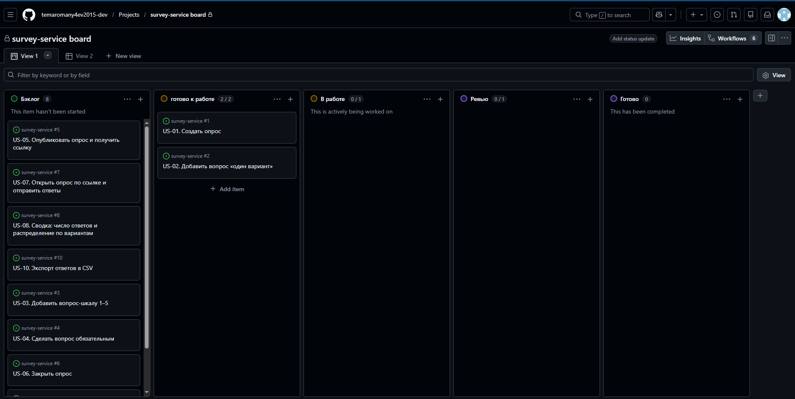

# Процесс команды: методология, доска, WIP-лимиты, DoR и DoD

## 1. Цель

Выбрать методологию, настроить доску задач с WIP-лимитами, обоснованными законом Литтла, и зафиксировать Definition of Ready и Definition of Done (задание 1.6).

## 2. Исходные данные

- Команда из одного человека, проект «Сервис опросов» (Python / FastAPI), срок до защиты ЛР 3 условно 3 недели (до 01.12.2026).
- 10 историй в бэклоге, MVP из 6 историй (23 SP), ёмкость 15,4 ч чистой работы в неделю ([release-plan.md](release-plan.md)).
- В ЛР 4 по данным трекера будут считаться метрики потока (`flow_metrics.py`): время цикла, пропускная способность, возраст задач. Процесс должен давать для них данные.

## 3. Выбор методологии

**Выбрано: Scrumban**, то есть доска Kanban с WIP-лимитами и непрерывным потоком, плюс лёгкий недельный ритм из Scrum (планирование и обзор раз в неделю, без спринтов и ролей).

| Фактор | Что у нас | Куда склоняет |
|---|---|---|
| Размер команды | 1 человек | Kanban: Scrum-роли (владелец продукта, скрам-мастер) и события для одного человека формальны |
| Стабильность приоритетов | порядок задан WSJF и рюкзаком, но может измениться (триггер на 24.11 про US-10) | Kanban: приоритеты можно менять в любой момент, не дожидаясь конца спринта |
| Размер и однородность работы | истории от 1 до 5 SP, можно закончить за 1–3 дня | Kanban: поток небольших задач без привязки к фиксированному объёму итерации |
| Фиксированная дата | защита 01.12.2026, нужен прогноз | Scrum-элемент: еженедельный цикл «планирование → обзор» и прогноз Монте-Карло |
| Измеримость процесса | в ЛР 4 нужны время цикла и пропускная способность | Kanban: эти метрики естественны для потока |
| Риск перегрузки | один исполнитель, рюкзак заполнен полностью | Kanban: WIP-лимиты не дают начать лишнего |

Итог: фиксированные спринты без команды не нужны, а недельная дисциплина (план на неделю, обзор в конце) полезна из-за жёсткой даты. Отсюда Scrumban.

Примечание: факторы выбраны по общим критериям выбора методологии; при необходимости названия факторов можно привести к формулировке из лекции 2, содержание вывода от этого не меняется.

## 4. Доска задач

Доска: GitHub Projects (Board), проект «survey-service board», привязан к репозиторию. Колонки отражают реальные этапы работы над историей:

| Колонка | Что означает | Правило входа | WIP-лимит |
|---|---|---|---|
| Бэклог | все истории, упорядоченные по приоритету (WSJF) | история создана | нет |
| Готово к работе | история соответствует DoR, её можно брать сразу | выполнен DoR | 2 |
| В работе | идёт разработка в ветке | назначен исполнитель, метка `in progress`, создана ветка | 1 |
| Ревью | открыт pull request, идёт проверка по чек-листу | PR создан, тесты зелёные | 1 |
| Готово | выполнен DoD | PR влит, issue закрыт | нет |

На карточке хранятся поля: **SP** (оценка), **WSJF** (приоритет), ссылка на issue и PR. Линия MVP: US-01, 02, 05, 07, 08, 10; истории US-03, 04, 06, 09 лежат в «Бэклоге» ниже линии.

Для метрик потока (ЛР 4) начало работы фиксируется назначением исполнителя или меткой `in progress`, завершение — закрытием issue. Поэтому при переносе карточки в «В работе» исполнитель назначается и ставится метка; закрытие issue происходит автоматически при слиянии PR со словами `Closes #N`.

Скриншот доски: 

## 5. WIP-лимиты и закон Литтла

Закон Литтла: **WIP = пропускная способность × время цикла** (среднее число задач в системе равно скорости их завершения, умноженной на среднее время, которое задача проводит в системе).

Исходные значения:

- Пропускная способность λ = **2 истории в неделю**. Это осторожная оценка по ёмкости: 15,4 ч в неделю при средней истории 47,5 / 6 ≈ 7,9 ч даёт ≈ 1,95 истории в неделю (условное значение 2,5 из прогноза Монте-Карло оптимистичнее).
- Время цикла в «В работе»: средняя история 7,9 ч при 15,4 / 5 ≈ 3,1 ч работы в день занимает ≈ 2,6 рабочего дня, то есть **0,5 недели**.
- Время в «Ревью»: самопроверка по чек-листу и ожидание зелёных тестов ≈ 1 рабочий день, то есть **0,2 недели**.

Расчёт:

| Колонка | Формула | Результат | Лимит |
|---|---|---|---|
| В работе | 2 × 0,5 | 1,0 | **1** |
| Ревью | 2 × 0,2 | 0,4, округляем вверх до минимально возможного | **1** |
| Готово к работе | запас на 1 неделю: 2 × 1,0 | 2,0 | **2** |
| В работе + Ревью вместе | 2 × (0,5 + 0,2) | 1,4, округляем вверх | не более **2** |

Что это даёт:

- один человек не может эффективно вести две разработки сразу; лимит 1 в «В работе» запрещает начинать новую историю, пока текущая не ушла на ревью;
- лимит 1 в «Ревью» заставляет довести PR до слияния до открытия следующего, а не копить непроверенное;
- запас «Готово к работе» не даёт простоя при смене истории, но и не позволяет готовить впрок больше, чем нужно на неделю.

В GitHub Projects лимит колонки мягкий: он подсвечивается при превышении, но не блокирует перенос, поэтому соблюдать его нужно самостоятельно. После накопления данных (ЛР 4) лимиты проверяются по фактическому времени цикла и пересматриваются.

## 6. Definition of Ready (когда историю можно брать в работу)

Карточка попадает в «Готово к работе», только если выполнено всё:

- [ ] история сформулирована: «Как <роль> я хочу <действие>, чтобы <ценность>»;
- [ ] есть критерии приёмки в формате «Дано / Когда / Тогда»;
- [ ] история оценена в SP и не больше 8 SP (иначе разбивается);
- [ ] у истории есть приоритет (WSJF);
- [ ] все истории, от которых она зависит, в статусе «Готово» (зависимости из [release-plan.md](release-plan.md));
- [ ] понятно, что нужно сделать, без дополнительных вопросов; если нужны уточнения, они записаны в issue;
- [ ] известны входные и выходные данные (поля запроса и ответа API в общих чертах).

## 7. Definition of Done (когда историю можно считать завершённой)

Карточка попадает в «Готово», только если выполнено всё:

- [ ] код написан в отдельной ветке и влит в `main` через pull request, связанный с issue (`Closes #N`);
- [ ] выполнена проверка по чек-листу ревью ([team-agreement.md](team-agreement.md), раздел «Правила ревью»);
- [ ] все критерии приёмки истории проверены и выполняются;
- [ ] написаны автотесты на основные сценарии и ошибки, все тесты проходят (`pytest`);
- [ ] линтер и форматтер не выдают замечаний, если они настроены; проверки CI зелёные, если CI настроен;
- [ ] документация API (Swagger / OpenAPI) отражает изменения;
- [ ] в коде и истории коммитов нет секретов и паролей;
- [ ] при необходимости обновлены README и документы в `docs/`;
- [ ] issue закрыт, карточка перенесена в «Готово».

## 8. Выводы

- Выбран Scrumban: поток небольших задач с WIP-лимитами и недельным ритмом, потому что команда состоит из одного человека, а срок жёсткий.
- Доска из пяти колонок отражает реальный путь истории; лимиты по закону Литтла: «Готово к работе» 2, «В работе» 1, «Ревью» 1.
- DoR и DoD сформулированы чек-листами; для метрик ЛР 4 договорено фиксировать начало (исполнитель или метка `in progress`) и конец (закрытие issue) работы.