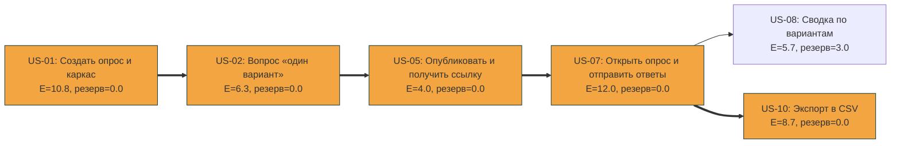
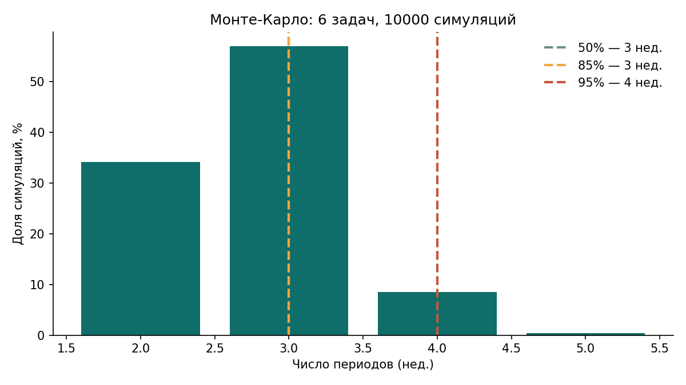

# План релиза MVP: сетевой график, PERT, прогноз Монте-Карло

## 1. Цель

Построить сетевой график историй MVP, найти критический путь и резервы, оценить вероятность завершить MVP к дате защиты ЛР 3 методом PERT и сделать вероятностный прогноз методом Монте-Карло (задание 1.5).

## 2. Исходные данные

- Состав MVP (решение задачи о рюкзаке, [prioritization.md](prioritization.md)): US-01, US-02, US-05, US-07, US-08, US-10, всего 23 SP.
- Оценки в часах (O, M, P) по трём точкам, 1 SP ≈ 2 ч ([estimates.md](estimates.md), `data/pert_hours.csv`). Для US-05, которая не входила в пятёрку самых неопределённых, часы получены тем же пересчётом: 1/2/3 SP → 2/4/6 ч. Все исходные данные: [data/tasks.csv](data/tasks.csv).
- **Допущения, принятые для расчёта** (даты защиты в задании нет, поэтому она задана условно):
  - работа идёт с 10.11.2026; **защита ЛР 3 условно назначена на 01.12.2026** (3 недели, как в расчёте ёмкости в [prioritization.md](prioritization.md));
  - ёмкость: 22 ч в неделю × коэффициент фокуса 0,7 = **15,4 ч чистой работы в неделю**; за 3 недели это **46,2 ч**. Именно это число используется как срок («дедлайн») в часах;
  - зависимости между историями (логические, по сквозному пути «создать → наполнить → опубликовать → пройти → посмотреть/выгрузить»):

| История | Зависит от | Почему |
|---|---|---|
| US-01 Создать опрос и каркас | — | основа, в ней же каркас проекта |
| US-02 Вопрос «один вариант» | US-01 | вопрос принадлежит опросу |
| US-05 Опубликовать, получить ссылку | US-02 | пустой опрос публиковать нельзя |
| US-07 Открыть опрос и отправить ответы | US-05 | респондент открывает только опубликованный опрос |
| US-08 Сводка по вариантам | US-07 | сводка строится по ответам |
| US-10 Экспорт в CSV | US-07 | экспорт строится по ответам |

  - длительности независимы (требование PERT); распределение суммы считаем нормальным.

## 3. Ход выполнения

### 3.1. Сетевой график


Исходник диаграммы (Mermaid, GitHub отрисовывает его сам; оранжевым выделен критический путь):



### 3.2. Расчёт по методу критического пути

Для каждой истории: E = (O + 4M + P) / 6, σ = (P − O) / 6. ES/EF — ранние начало и конец, LS/LF — поздние, резерв = LS − ES. Вывод скрипта `pert_cpm.py` (полный: [data/pert_cpm_output.txt](data/pert_cpm_output.txt)):

| ID | E, ч | σ, ч | ES | EF | LS | LF | Резерв, ч |
|---|---|---|---|---|---|---|---|
| US-01 | 10,83 | 2,17 | 0,00 | 10,83 | 0,00 | 10,83 | 0,00 |
| US-02 | 6,33 | 1,33 | 10,83 | 17,17 | 10,83 | 17,17 | 0,00 |
| US-05 | 4,00 | 0,67 | 17,17 | 21,17 | 17,17 | 21,17 | 0,00 |
| US-07 | 12,00 | 3,33 | 21,17 | 33,17 | 21,17 | 33,17 | 0,00 |
| US-08 | 5,67 | 1,33 | 33,17 | 38,83 | 36,17 | 41,83 | **3,00** |
| US-10 | 8,67 | 2,00 | 33,17 | 41,83 | 33,17 | 41,83 | 0,00 |

- **Критический путь: US-01 → US-02 → US-05 → US-07 → US-10**, ожидаемая длительность **41,83 ч**.
- Единственная история с резервом: **US-08, резерв 3,00 ч**. Она может сдвинуться на 3 часа, не затрагивая срок проекта. Остальные задержки сдвигают весь релиз.
- Самое рискованное звено пути: US-07 (σ = 3,33 ч, самый большой разброс).

### 3.3. Вероятность завершения к защите по PERT

σ проекта берётся по критическому пути: σ = √(2,17² + 1,33² + 0,67² + 3,33² + 2,00²) = √22,03 ≈ **4,69 ч**.

Вероятность уложиться в срок T = 46,2 ч:

```
z = (T − E) / σ = (46,2 − 41,83) / 4,69 = 0,93      →      Φ(0,93) ≈ 0,82
```

| Вероятность | Срок, ч | Срок в неделях (÷ 15,4) |
|---|---|---|
| 50% | 41,83 | 2,7 |
| 85% | 46,71 | 3,0 |
| 95% | 49,58 | 3,2 |

**По формальному PERT (скрипт `pert_cpm.py`) вероятность завершить MVP к 01.12.2026 равна 82,4%.**

### 3.4. Поправка на одного исполнителя

`pert_cpm.py` считает срок по критическому пути, то есть предполагает, что US-08 и US-10 делаются параллельно. Исполнитель один, поэтому реально они делаются друг за другом, и срок равен сумме **всех** шести историй. Расчёт (`scripts/pert_single_worker.py`, [data/pert_single_worker_output.txt](data/pert_single_worker_output.txt)):

| Сценарий | Историй | E, ч | σ, ч | Срок при P = 85%, ч | Вероятность уложиться в 46,2 ч |
|---|---|---|---|---|---|
| Весь MVP последовательно | 6 | 47,50 | 4,88 | 52,57 | **39,5%** |
| MVP без US-10 | 5 | 38,83 | 4,45 | 43,46 | **95,1%** |

Вывод: формально (82%) срок достижим, но для одного человека MVP занимает почти всю ёмкость (47,5 ч при 46,2 ч в запасе), и вероятность успеха ниже 40%. Это ожидаемо: рюкзак заполнен до отказа (23 SP из 23). Пять историй с резервом укладываются с вероятностью 95%.

**Решение по управлению риском:**

1. Порядок работы: US-01 → US-02 → US-05 → US-07 → **US-08** → US-10 (US-08 раньше US-10: у неё выше WSJF, [prioritization.md](prioritization.md)).
2. US-10 «Экспорт в CSV» объявлена **буферной историей**: она последняя на критическом пути и первой уходит из MVP.
3. Триггер: если к концу 2-й недели (24.11.2026) US-07 не доведена до «Готово», US-10 переносится за линию MVP, а в документах фиксируется пересмотр состава релиза.

### 3.5. Прогноз Монте-Карло

Метод: берём историю пропускной способности (сколько историй завершено за неделю) и 10 000 раз «проигрываем» будущие недели, случайно выбирая значения из истории (скрипт `scripts/monte_carlo.py`, seed = 42, вывод: [data/monte_carlo_output.txt](data/monte_carlo_output.txt)).

Собственных данных пока нет, поэтому использована **условная история** из 8 недель со значениями от 1 до 4 историй в неделю ([data/throughput_assumed.csv](data/throughput_assumed.csv)): 2, 3, 1, 4, 3, 2, 3, 2, среднее 2,5 истории в неделю. В ЛР 4 файл будет заменён реальными данными (`throughput_weekly.csv` из `flow_metrics.py`), прогноз пересчитан той же командой.

Результаты для 6 историй MVP:

| Вероятность | Срок завершения 6 историй MVP |
|---|---|
| 50% | не позже чем за 3 нед. |
| 70% | не позже чем за 3 нед. |
| **85%** | **не позже чем за 3 нед.** |
| 95% | не позже чем за 4 нед. |

Распределение срока: 2 нед. — 34,2%, 3 нед. — 57,0% (накопленно 91,1%), 4 нед. — 8,5%, 5 нед. — 0,4%. **Вероятность завершить 6 историй за 3 недели: 91,1%.** Для сравнения: весь бэклог из 10 историй завершается не позже чем за 4 недели с вероятностью 50% и за 5 недель с вероятностью 85%.



**Прогноз: MVP (6 историй) будет готов не позже чем за 3 недели (к 01.12.2026) с вероятностью 50% и с вероятностью 85%.**

### 3.6. Почему Монте-Карло оптимистичнее PERT

Монте-Карло показал 91%, а PERT с поправкой на одного человека — 39,5%. Причины:

- условная история даёт 2,5 истории в неделю, а ёмкость 15,4 ч в неделю при средней истории 47,5 / 6 ≈ 7,9 ч означает ≈ 1,95 истории в неделю; условные данные оптимистичнее нашего плана;
- Монте-Карло считает все истории одинаковыми по размеру, а у нас от 2 до 12 ч (самая крупная, US-07, лежит на критическом пути);
- условная история не содержит реальных простоев и срывов.

Поэтому за основу принят **осторожный** вывод: к защите вероятность успеха для полного MVP ближе к нижней оценке (≈ 40–80%), для MVP без US-10 она высока (≈ 95%). В ЛР 4 прогноз будет пересчитан по реальной пропускной способности.

## 4. Выводы

- Критический путь: US-01 → US-02 → US-05 → US-07 → US-10, 41,83 ч; резерв только у US-08 (3,00 ч).
- Вероятность завершить MVP к условной дате защиты 01.12.2026: 82,4% по PERT (критический путь), 39,5% при последовательной работе одного исполнителя.
- Монте-Карло по условной истории: 6 историй MVP за 3 недели с вероятностью 50% и 85%, оценка вероятности 91%.
- Главные риски: US-07 (σ = 3,33 ч) и перегруженная ёмкость. Меры: буферная история US-10, триггер пересмотра на 24.11.2026, пересчёт прогноза в ЛР 4.

## 5. Как воспроизвести

Из корня репозитория:

```
python scripts/pert_cpm.py docs/01-planning/data/tasks.csv --deadline 46.2 --mermaid
python scripts/pert_single_worker.py docs/01-planning/data/tasks.csv --deadline 46.2 --drop US-10
python scripts/monte_carlo.py --csv docs/01-planning/data/throughput_assumed.csv --backlog 6 --plot docs/01-planning/img/monte_carlo.png
```